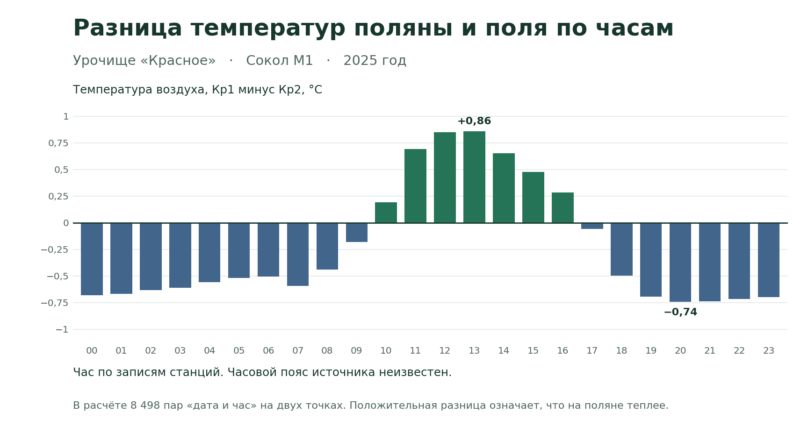

# Умная аналитика метеоданных

**Кейс 02 «Заповедного хакатона» · Центрально-Лесной заповедник · урочище Красное.**

Скачайте HTML и откройте «Наблюдения», чтобы настроить дашборд, разметить архив и сравнить суточные прогнозы. Бизнес-кабинет формирует PDF с выводами, покрытием и экспертными отметками. [Интерактивное демо](docs/demo/station-atlas.html) · [Пример PDF для руководителя](docs/demo/decision-report.pdf) · [Запуск платформы](docs/platform.md)

Сотрудники заповедника вручную сводят наблюдения станций в Excel, рассчитывают суточные средние и строят графики. Задача команды — автоматизировать эту работу. Пользователь выбирает ряд, параметр и период и получает согласованные таблицу, график и статистику. Он может исследовать тенденции и отклонения от среднего и проверить, какие наблюдения вошли в расчёт. Основание — задание, стр. 1 и 3.

**Текущая сборка** — кабинеты исследователя и бизнеса, импорт и QC, отчёты, воспроизведение потока, спутниковая вкладка. [Запуск и демо](docs/platform.md) · [Текущий промпт команды](CURRENT_PROMPT.md) · [Предметный EDA](docs/data-audit.md) · [Поляна и поле, 2025](docs/comparison-2025.md) · [Хакатоны, сервисы и инженерные источники](docs/research.md) · [Четыре английских промта](docs/agent-prompts.md).

## Почему этот сценарий стоит защищать

На Кр1 в апреле 2024 года зарегистрировано 1 389 записей. Для температуры воздуха пригодны 28 из 30 суток, среднее по этим суточным средним **+7,61 °C**. В той же выгрузке у давления 1 272 значения помечены флагом выхода за диапазон. Для расчёта пригодны лишь **2 из 30 суток**, а 28 неполных суток идут подряд. По правилам задания месячное давление публиковать нельзя. Отбрасывание всех строк с любым флагом испортило бы и расчёт температуры.

Это проверка метода, прямо предусмотренная заказчиком. Самостоятельный аналитический сюжет даёт сравнение поляны и поля. В 2025 году средняя разность температур **Кр1 минус Кр2 равна −0,19 °C** на 361 общей пригодной дате. При разложении по часам знак меняется: в 13-й час по времени станций разность **+0,86 °C** на 351 паре дата–час, в 20-й **−0,74 °C** на 353 парах. По этим записям можно показать, что годовое среднее скрывает внутри суток. Причину различий и часовой пояс из измерений установить нельзя.



## Задание и порядок реализации

| Приоритет | Результат | Как показывает команда |
|---|---|---|
| 1. Основной поток по АМЕ-60 | Выбрать любой доступный период и параметр, получить таблицу, график и статистику. Включить сутки, декады и месяцы. Анализировать тенденции внутри ряда и отклонение от среднего за выбранный период | Воспроизвести знакомую пользователю сводку Excel. Показать единицы, референсные годы, число лет и покрытие параметра. Таблица и график используют одну выборку |
| 2. Проверяемость | Сделать видимой причину исключения целой строки, отдельного значения, суток или месяца | Из ячейки таблицы перейти к датам и флагам. Пропуск в ряду остаётся разрывом на графике |
| 3. Первые дополнительные задачи со стр. 3 | Дать таблицы и графики по Сокол М1, включить давление, затем сравнение «поляна vs поле» за 2025 год | На одной станции поменять параметр в апреле 2024. На двух станциях сопоставить месячную разность температур и средний суточный ход |
| 4. Остальные дополнительные задачи со стр. 3 | Добавить импорт нового файла того же формата, затем краткосрочный прогноз для района из внешнего API | Для импорта показать предпросмотр, обновление и повторную загрузку без дублей. У прогноза указать провайдера, время выпуска, срок и состояние при недоступности сервиса |

Порядок — предложение команды. В трёхстраничном PDF перечислены обязательная поставка, варианты реализации и дополнительные задачи. Балльные веса и длительность защиты там не приведены. API прогноза и новая собственная прогнозная модель в основной аналитический сценарий не входят. Для остальных метеопараметров тоже определить осмысленную статистику: в частности, направление ветра требует кругового представления, а среднее 359° и 1° лежит рядом с севером.

## Правила, которые должны совпасть с брифом

| Что считается | Контракт расчёта и UX |
|---|---|
| Ряд и время | АМЕ-60, Кр1 и Кр2 хранятся с разными ключами. АМЕ-60 и Сокол М1 не имеют совместного периода. Исключить склеенный тренд через 2021/2022. Сохранять исходные метки минут и пояснять, что часовой пояс не подтверждён |
| Качество отдельного значения | Флаг вида «параметр:причина» исключает только этот параметр. Строка с `dup_conflict` исключается целиком. Отсутствие колонки, пропуск и измеренный ноль различимы |
| Сутки | АМЕ-60 — минимум 72 различных срока из 96. Сокол — не менее 18 различных часов из 24 для выбранного параметра. Среднее за пригодные сутки считать по всем его валидным наблюдениям, включая несколько записей в одном часе |
| Месяц и декады | Месяц валиден при максимум 10 неполных днях и максимальной серии неполных дней меньше 5. Декады — 1–10, 11–20, 21–последний день. Для частичного пользовательского интервала подписать фактические даты и полноту календарного периода |
| Многолетнее сравнение | Зафиксировать станцию, показатель, календарный месяц и базовый период. Показывать число фактически вошедших лет и название «среднее за выбранный период». В EDA валидные сутки имеют равный вес внутри месяца, годы — равный вес в базе |
| Визуализация тренда | Строить по сопоставимым агрегатам одного ряда, подписывать интервал и его покрытие. Промежуток без данных 1999–2003 не заполнять. Метод, минимальное число точек и сезонность указать до интерпретации наклона |

## Первый экран и настройки

**Сначала выборка и ответ.** В шапке — станция и тип прибора, показатель с единицей, даты и масштаб агрегации. Под ними — значение или причина его отсутствия, число валидных дней и период сравнения. Временной ряд и таблица связаны: выбор месяца в графике раскрывает те же сутки в таблице. Клик по неполному месяцу объясняет, сколько дней отсутствует и какое правило нарушено. Для параметра, которого прибор не измеряет, дать явное объяснение.

**Что настраивает пользователь.** Место, параметр, даты, детализацию, базовые годы, вид таблицы или графика и при необходимости видимые колонки. Фильтры сохраняются в ссылке, есть сброс к исходному виду. Единицы, обязательные правила качества и полноты хранятся в версии методики и действуют одинаково для таблицы, графика и выгрузки. Исследовательские настройки порогов потребовали бы отдельного режима с явной пометкой пересчёта.

**Как выбирать следующую функцию.** Сначала выполнить обязательную задачу из PDF. Затем проверить, есть ли в датасете материал для демонстрации, какая ошибка возникнет у пользователя без функции и сколько стоит её проверить. По этим основаниям разбор пропусков и парное сравнение попадают в демо раньше прогнозного виджета. Карту для трёх рядов из одного урочища имеет смысл добавлять, только если сотруднику нужна пространственная ориентация для конкретной задачи.

## Стек и выпуск

| Компонент | Предложение и его основание |
|---|---|
| Обработка | Python и SQL в DuckDB. Здесь 35 CSV наблюдений и 874 560 строк; вычислительное ядро можно запускать локально и сверять с независимым расчётом. Стандартизованные суточные и месячные таблицы хранить в Parquet. Базовые агрегаты и выборку исходных записей измерить по отдельности перед фиксацией формата поставки |
| Интерфейс | TypeScript, React и Vite, один интерактивный график и связанная с ним доступная таблица. Проверить чтение русских подписей, клавиатуру и узкий экран. Локальные ресурсы позволяют провести основную демонстрацию без сети |
| Доставка | Для стартового архива отдавать готовые срезы по станции и периоду, подгружать первичные наблюдения по запросу. Локальный процесс импорта может обновлять данные атомарно. Решение о серверном API принять по замерам и по тому, где пользователю нужно загружать новые файлы |
| Критерий релиза | Один документированный запуск из чистой копии, версия данных, инструкция обновления, тесты расчётов и сквозного пользовательского сценария в CI. Замерить задержку первой загрузки и смены параметра на указанном устройстве; записывать только фактические результаты |
| Проверка разработки | Модульные тесты границ 71/72 срока, 17/18 часов, 10/11 пропущенных дней, 4/5 последовательных пропусков. Интеграционная проверка воспроизводит апрель Кр1 и сверяет результаты с независимым расчётом. Playwright проверяет основной сценарий, пропуски и сохранение фильтров. Отчёт о покрытии выделяет вычислительное ядро |

В ШАД полезен образец воспроизводимого аналитического окружения, у AWS Deequ — исполняемые проверки качества данных, у Microsoft — критерии выпуска и браузерные проверки пользовательских действий. Конкретные первоисточники и границы переноса собраны в [обзоре](docs/research.md).

## Как воспроизвести EDA

Оригинальный `meteo_hack_dataset.zip` и [PDF задания](data/raw/case-2-weather.pdf) лежат в `data/raw/`. SHA-256 архива — `8c574c518617aea0f301997c62dfe75dc09b059abca1cdbd268645a3cd6cc33d`. Скрипты запускаются из корня репозитория. [Расчёт покрытия](docs/data-audit.md) и [метод сравнения площадок](docs/comparison-2025.md) включают команды запуска и точные определения показателей.

```sh
python3 tools/profile_archive.py data/raw/meteo_hack_dataset.zip > profile.json
python3 -m unittest discover -s tests -v
```

Первый скрипт проверяет состав ZIP и структуру CSV/TSV, число записей и пустых ячеек. Предметные решения о валидности измерений принимаются отдельным расчётом по правилам метеостанций.

## Как защитить проект

| Время репетиции | Действие на экране | Что это доказывает |
|---|---|---|
| 0:00–0:25 | Сотруднику заповедника нужна месячная сводка. Показать, какие операции он делает в Excel | Понятен текущий процесс и пользователь продукта |
| 0:25–1:00 | На базовом АМЕ-60 выбрать температуру января, годы сравнения и раскрыть статистику | Требуемый поток работает. Для 1992–2021 в базу фактически входят 13 январей; среднее по ним −7,57 °C |
| 1:00–1:45 | На Кр1 открыть апрель 2024, переключить температуру на давление и показать календарь пригодных дней | Сервис автоматически применяет правила к выбранному параметру и объясняет разные ответы |
| 1:45–2:25 | Сравнить поляну и поле в 2025 году. Переключить годовое среднее на ход по часам | Небольшая годовая разница скрывает измеримое изменение знака внутри суток. Показаны парные наблюдения и размер выборки |
| 2:25–3:00 | Показать независимую сверку, запуск и одно наблюдение из UX-теста | Команда может передать воспроизводимый результат сотруднику заповедника |

Три минуты — предложенный формат репетиции. Для UX-проверки дать сотруднику или близкому по опыту аналитику два задания: получить январскую сводку и выяснить, почему за апрель нет давления. Зафиксировать правильность ответа, время и первую точку затруднения в Excel и в приложении. Каждое заявленное ускорение подкрепить реальными замерами с числом участников. До такой проверки формулировать сокращение ручных операций как цель проекта.

## Четыре направления для согласования

1. **Данные и методика.** Контракт расчёта, EDA и воспроизводимые контрольные числа.
2. **Продукт и UX.** Путь от вопроса сотрудника до сводки, проверка понимания причин исключений.
3. **Инженерия.** Единое вычислительное ядро, интерфейс, настраиваемые фильтры и поставка.
4. **QA и защита.** Независимые эталоны, регрессии, чистый запуск и демонстрация с доказательствами.

[Английские формулировки для агентов](docs/agent-prompts.md) подготовлены для обсуждения. Назначение людей на роли остаётся за командой.
