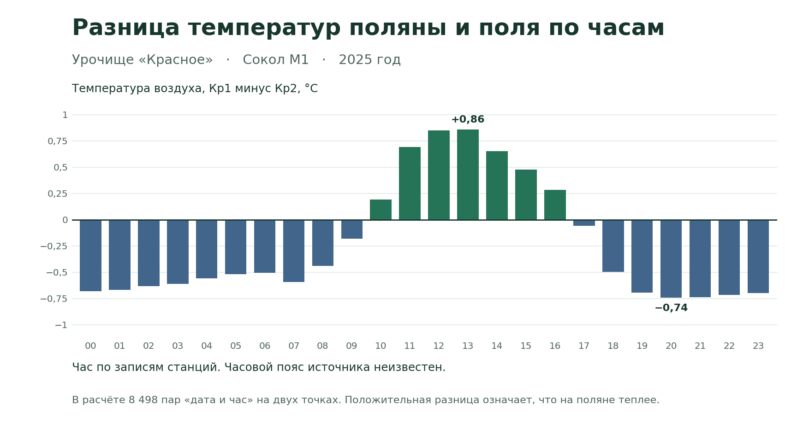

# Когда в 2025 году на поляне было теплее, чем в поле?

За 361 общий день средняя температура на поляне Кр1 составила 6,19 °C, в поле Кр2 — 6,38 °C. За этой небольшой разницей скрывается смена знака в течение суток. С 10-го по 16-й час включительно на поляне в среднем теплее. Самая большая положительная разница наблюдалась в интервале 13:00–13:59 (+0,86 °C, 351 пара), самая большая отрицательная — в 20:00–20:59 (−0,74 °C, 353 пары). Время приведено по записям станций. Часовой пояс источника неизвестен.



## Разница по месяцам

В каждой строке обе температуры рассчитаны по одним и тем же датам. Разница в последнем столбце равна температуре поляны минус температура поля. Среднее за год даёт каждому из 361 общих дней равный вес. Все 12 месяцев прошли проверку покрытия на общих датах.

| Месяц | Общие дни | Поляна, °C | Поле, °C | Разница, °C |
|---|---:|---:|---:|---:|
| Январь | 31 | −1,103 | −0,918 | −0,185 |
| Февраль | 28 | −6,891 | −6,327 | −0,563 |
| Март | 31 | 2,002 | 2,564 | −0,562 |
| Апрель | 30 | 6,544 | 6,772 | −0,227 |
| Май | 29 | 9,880 | 9,730 | +0,150 |
| Июнь | 30 | 14,465 | 14,435 | +0,031 |
| Июль | 30 | 19,046 | 19,027 | +0,019 |
| Август | 30 | 14,150 | 14,384 | −0,234 |
| Сентябрь | 30 | 11,376 | 11,944 | −0,568 |
| Октябрь | 31 | 5,623 | 5,617 | +0,006 |
| Ноябрь | 30 | 1,446 | 1,502 | −0,056 |
| Декабрь | 31 | −2,273 | −2,163 | −0,110 |
| **Год** | **361** | **6,194** | **6,385** | **−0,191** |

## Средний суточный ход

Для каждого часа сопоставлены только те даты, когда обе станции записали температуру в этом часовом интервале. Всего 8 498 пар «дата и час», на каждый час приходится от 348 до 359 дат. Числа в таблицах округлены после всех вычислений.

| Час по станции | Пар дат и часов | Поляна, °C | Поле, °C | Разница, °C |
|---|---:|---:|---:|---:|
| 00 | 356 | 3,969 | 4,652 | −0,682 |
| 01 | 358 | 3,777 | 4,446 | −0,669 |
| 02 | 359 | 3,493 | 4,126 | −0,633 |
| 03 | 355 | 3,230 | 3,841 | −0,611 |
| 04 | 357 | 3,148 | 3,706 | −0,557 |
| 05 | 359 | 3,155 | 3,674 | −0,518 |
| 06 | 356 | 3,234 | 3,741 | −0,507 |
| 07 | 358 | 3,834 | 4,427 | −0,592 |
| 08 | 352 | 4,667 | 5,108 | −0,441 |
| 09 | 354 | 5,893 | 6,076 | −0,183 |
| 10 | 354 | 7,279 | 7,089 | +0,190 |
| 11 | 352 | 8,491 | 7,798 | +0,694 |
| 12 | 350 | 9,156 | 8,305 | +0,851 |
| 13 | 351 | 9,657 | 8,800 | +0,857 |
| 14 | 355 | 9,815 | 9,165 | +0,650 |
| 15 | 350 | 9,581 | 9,105 | +0,476 |
| 16 | 350 | 9,371 | 9,085 | +0,286 |
| 17 | 353 | 8,777 | 8,836 | −0,059 |
| 18 | 352 | 7,636 | 8,133 | −0,497 |
| 19 | 348 | 6,577 | 7,273 | −0,696 |
| 20 | 353 | 5,881 | 6,623 | −0,742 |
| 21 | 355 | 5,071 | 5,810 | −0,739 |
| 22 | 356 | 4,524 | 5,240 | −0,717 |
| 23 | 355 | 4,169 | 4,865 | −0,697 |

## Из чего складывается одно число

1. В двух таблицах Сокол М1 за 2025 год хранится 12 302 записи Кр1 и 11 992 записи Кр2. У каждой записи есть значение `t_air`, все `qc_flag` в этих двух файлах пусты. Общий алгоритм отбрасывает пустую температуру, флаги `t_air:…` и строки `dup_conflict`. Например, флаг давления оставляет температуру пригодной для сравнения.
2. Для каждого дня каждой станции считаем число разных часов с валидной температурой. Порог задания — 18 из 24. В Кр1 его прошли 365 дат, в Кр2 — 361. Исключены четыре даты Кр2: 23 мая (15 часов), 27 мая (14), 9 июля (16) и 3 августа (16). На общих днях также проверяем месячный лимит — до 10 пропущенных дней и до четырёх подряд.
3. Для месячной таблицы строим среднюю температуру каждой точки за день по **всем её валидным срокам**, как требует кейс. В пределах даты каждый срок имеет равный вес, включая несколько сроков в течение часа. Затем считаем разность средних двух точек за одну дату. Дневные разности входят в месячное среднее с равным весом, поэтому день с получасовым шагом не перевешивает день с часовым шагом.
4. Для суточного хода сначала усредняем сроки одной точки внутри фактического интервала от HH:00 до HH:59. Затем соединяем точки по общей дате и часу, а результаты для каждого часа усредняем по доступным датам с равным весом. Например, записи 13:11 и 13:41 на одной точке дают одну оценку этого часа. Часы соседних интервалов не смешиваются, исходные отметки времени сохранены.
5. Месячная таблица и суточный ход отвечают на разные вопросы. В первой отдельное наблюдение входит в среднее своей даты. Во втором две точки сравниваются за один и тот же час, хотя минуты регистрации могут различаться. Итоги описывают конкретные приборы, две площадки и один год. Чтобы оценить влияние растительности, экспозиции или различия приборов, потребовались бы дополнительные измерения.

## Как перепроверить

Запуск из корня проекта требует Python 3.10 или новее. Для сохранения рисунка дополнительно нужен Matplotlib.

```sh
python3 tools/compare_sites.py data/raw/meteo_hack_dataset.zip
python3 -m unittest discover -s tests -p test_compare_sites.py -v
python3 tools/compare_sites.py data/raw/meteo_hack_dataset.zip --figure docs/diurnal-2025.png
```

Первый вызов возвращает JSON со средними по двум точкам, разницей и числом пар. Тест независимо загружает оба исходных CSV в SQLite, вычисляет средние и соединяет наблюдения SQL-запросами. Он сверяет температуры обеих станций, разницы и количество пар для всех 12 месяцев и 24 часов. Дополнительные тесты проверяют границы полноты, непарные часы, флаги и разные веса сроков и дней. Проверенная контрольная сумма SHA-256 архива — `8c574c518617aea0f301997c62dfe75dc09b059abca1cdbd268645a3cd6cc33d`.

Исходные правила приведены в кейсе 02 «Умная аналитика метеоданных» на странице 3 и в README внутри архива. Для расчётов используются `data/sokol_m1/kr1_2025.csv` и `data/sokol_m1/kr2_2025.csv` внутри каталога `meteo_clgz_hackathon` исходного ZIP.
