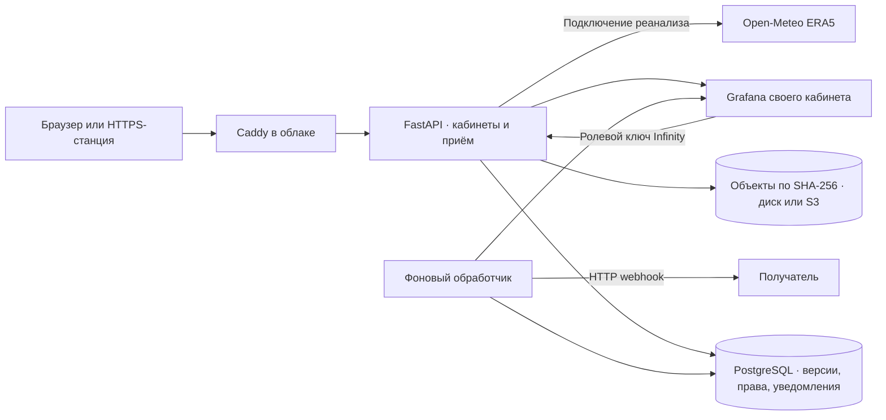

# Платформа метеонаблюдений. Паспорт демонстрационного выпуска

## Граница релиза и архитектура

Два кабинета обслуживают заранее заведённые рабочие пространства исследователя и компании. Личный ключ открывает восьмичасовую сессию. Исследователь импортирует набор приватно. Для работы компании нужны публикация владельцем и подключение конкретной версии. В этом выпуске один владелец и одна организация. Самостоятельная регистрация пользователей и управление сотрудниками требуют отдельной схемы идентификации.



FastAPI отдаёт кабинет без отдельной frontend-сборки. Браузерный JavaScript хранит порядок и названия колонок для выбранной роли на устройстве. При 35 файлах и 874 560 наблюдениях исходник и сжатые месячные разделы удобно адресовать хэшами. PostgreSQL обеспечивает транзакцию публикации, блокировку при получении потока, фиксацию версии, повторную доставку и сохранение результата. Станционные минуты и ссылки на исходные строки сохраняются. В облаке TLS завершается на Caddy. Два контейнера Grafana обслуживают разные пространства. Каждый получает свой серверный ключ исключительно к маршруту рядов и событий. Пользовательские фильтры передают выбор периода. Окончательное разрешение возвращать данные проверяет API. [Облачная конфигурация и команды](yandex-deployment.md)

## Как повторить проверки

```sh
python -m venv .venv
# Активируйте окружение для вашей ОС.
python -m pip install -r requirements.txt
python -m unittest discover -s tests -v
python tools/audit_meteo.py data/raw/meteo_hack_dataset.zip
python tools/demo_platform.py --base http://localhost:8123 --env .env
```

Последняя команда работает с локальными ролями из указанной конфигурации. Она импортирует архив, публикует только демонстрационный набор, подключает его бизнес-кабинету и воспроизводит сутки в локальном контуре. Произвольный входной файл сначала проходит предпросмотр. Сопоставление задаётся от канонической колонки к входной. Стандартные единицы указаны в предпросмотре. Для градусов Фаренгейта, Па и иных нестандартных единиц подготовьте согласованный вход в единицах схемы. Входящий поток принимает обычный JSON с полями `id`, `station`, `timestamp`, `values` и `flags`. Повтор идентичного сообщения сохраняет ревизию. Записи переупорядочиваются по времени измерения. Локальный приёмник webhook подтверждает отдельный HTTP-вызов и сохраняет ключ идемпотентности.

## Результаты проверки

| Что проверено | Результат |
|---|---|
| Полный исходный ZIP | На Windows через реальный HTTP и PostgreSQL импортировано 35 файлов и 874 560 записей. Первый предпросмотр с подтверждением занял 32,37 с. Независимая методика проекта сверяет 420 станционных месяцев. |
| Научные примеры | Январь АМЕ-60 2010 даёт −15,20 °C. Среднее за 1992–2021 годы составляет −7,57 °C по 13 пригодным январям. Апрель 2024 Кр1 даёт 28 пригодных дней станции и 2 по давлению. Суточный ряд и экспорт оставляют пропуски пустыми. |
| Форматы и права | 25 тестов прошли. Проверены эквивалентные CSV/JSON/XLSX, неоднозначное сопоставление, повтор импорта, контрольные примеры, сохранённые версии, правила, восстановление и устаревание. Бизнес-роль получила отказ при прямой выгрузке приватного набора, открытии его дашборда и попытке чтения через подстановку набора в действующий источник Infinity. |
| Стенд с PostgreSQL и двумя Grafana | PostgreSQL 18.1 и Grafana 13.3.1, две панели через весь локальный HTTP-путь, по 20 последовательных вызовов. Для исследователя медиана 108 мс и p95 193 мс, для компании 106 и 183 мс. Время относится к получению данных фреймов. |
| Браузер | Edge прошёл обе роли, просмотр таблицы, строки источника, сохранённый отчёт и печать. Четыре даты 29 апреля – 2 мая 2024 совпали в таблице, выгрузке и панели. При ширине 390 px горизонтального переполнения не обнаружено. |
| Источники | Онлайн получены 24 часа ERA5 за 1 апреля 2024 года. В карточке это реанализ с координатами сетки, моделью, единицами и исходным ответом. Российские карточки ведут к паспортам и процедурам получения данных. Проверен открытый доступ Open-Meteo, для коммерческого исторического API требуется соответствующий тариф. [Источники и лицензии](sources-platform.md) |
| Оповещения | Три архивных измерения отправлены через настоящий HTTP-вход локального стенда. Активное событие, восстановление и повторная активация получены. После подтверждения приёма первый запрошенный фрейм с событием пришёл через 31, 15, 31 мс. Отдельный HTTP-приёмник получил сообщения через 5,11, 3,94, 3,88 с. Опрос панели начинался сразу, повтор каждые 100 мс. Автообновление Grafana настроено на 30 с. |
| Эксперимент по заполнению пропусков | 742 блока, 15 824 скрытых станционных часа. Для коротких разрывов Кр1 MAE линейной интерполяции 0,29 °C. Для суток соседняя станция дала 1,36 °C MAE при покрытии 567/768 часов. Оценки экспортируются отдельно. [Исследование](gap-experiment.md) |

Декадный ряд использует пригодные суточные значения и показывает их количество. В произвольном диапазоне неполный календарный месяц или обрезанная декада маркируются `partial` и остаются без агрегата. Для ветра выводится распределение по направлениям в профиле. Пороговый сигнал использует пригодный показатель, продолжительность, число сроков и разрешённый перерыв. Воспроизведение архива проходит обработчик приёма и регистрируется как `replay`; запись, уже имеющая ссылку на файл, не увеличивает вес исходного наблюдения. При проверке самого HTTP-входа архивные записи передавались в выделенный лабораторный набор.

22 ноября 2026 года стек развёрнут в Docker Compose на ВМ Yandex Cloud с Ubuntu 24.04, двумя vCPU и 4 ГБ RAM. Вход обеих ролей, месячные отчёты, сохранение, выдача двух панелей каждой Grafana и проход через SSH-туннель проверены. Первичный импорт 35 файлов на ВМ занял 26,05 с. В каждом фрейме давления Кр1 за апрель 2024 года оказалось два пригодных дня, а 29 апреля набралось 15 часов. После загрузки и установки плагинов на диске 10 ГБ осталось около 815 МиБ. Облачный стенд открыт через SSH-туннель; публичный домен с HTTPS и реальный бакет ожидают отдельной приёмки. Внешний канал испытан на отдельном HTTP-получателе. Коммерческий ключ Open-Meteo, живая станция и облачная модель в этих проверках не участвовали.

## Три минуты на защите

1. **0:00–0:40.** Открыть исследовательский кабинет и выбрать архив организаторов. Показать один исходный файл, предварительные строки, предполагаемую станцию, единицы и подтверждение колонок. На время первичного импорта пояснить вес каждого пригодного дня.
2. **0:40–1:30.** На Кр1 выбрать апрель 2024 и давление. В таблице 2 полных дня из 30, по станции 28. Открыть 29 апреля и строки с флагами, показать 15 пригодных часов при пороге 18. Перейти в Grafana и скачать тот же срез.
3. **1:30–2:10.** Опубликовать демонстрационный набор и подключить его во втором кабинете. Сохранить январскую сводку АМЕ-60 за 2010 год. Показать −15,20 °C, версию, ссылку на сохранённый отчёт и печать.
4. **2:10–3:00.** В лабораторном потоке передать три реальные архивные температуры Кр1 за 1 апреля 2024 года: 9,20, 8,10 и 10,53 °C. Порог 9 °C, один пригодный срок и нулевая выдержка. Первая запись — 08:02, строка CSV 4350. Показать исходное и приёмное время, идентификатор уведомления в панели и у получателя. Обозначить воспроизведение архивных наблюдений.

## Контракты для четырёх задач команды

| Задача | Что передаёт | Приёмка |
|---|---|---|
| Импорт и качество | Подтверждённое сопоставление, SHA оригинала, манифест версии и строки со ссылкой на файл/номер | Эквивалентные форматы, повтор, отрицательные примеры, январь и апрель |
| Кабинеты и каталог | Публикация → подключение версии → отчёт/экспорт с фильтрами и единицами | Обе роли проходят сквозной маршрут, приватная версия закрыта, снимок воспроизводим |
| Grafana, поток и алерты | Ролевой источник, стабильный UID, вход с ключом, идентификатор события и доставляемый webhook | Проверка подстановки набора, запоздание, повтор, восстановление и сверка ID у получателя |
| Валидация и выпуск | CI, Git-коммит, Compose, измерения, протокол облачной приёмки | Чистый запуск, контрольные числа, тест браузера, внешняя HTTPS-ссылка |

## Интерфейс агента следующего этапа

Контекст каждого вызова включает аутентифицированного пользователя, `dataset`, `version`, `revision`, станцию, показатель и период. Сначала сервер проверяет доступ к версии через ту же функцию, что при выдаче таблицы. К разрешённым данным добавляет единицу, метод, покрытие и ссылку на отчёт. Каталожные ключи, SQL и ключи источников модели не выдаются.

| Функция | Вход | Результат |
|---|---|---|
| forecast | Дата выпуска, горизонт, координаты или станция и провайдер | Прогноз по горизонту, единица, источник, неопределённость при наличии калибровки; отдельный тип данных |
| draft_report | Зафиксированный отчёт и выбранные события | Черновик с проверяемой ссылкой у каждого числа, статус «на проверке» |
| render_pdf | Утверждённый снимок и версия шаблона | Воспроизводимый PDF с таблицей, графиками, единицами и ссылками |

Встроенная печать уже работает. Отдельный форматированный PDF и прогноз агентом остаются следующим этапом. Для индикатора засухи нужны осадки, станция, шаг накопления и пригодная историческая база. В этом архиве осадки отсутствуют, поэтому статус такого индикатора — «недостаточно данных». Для эксплуатации требуется выбрать шкалу накопления SPI и подтвердить историческое распределение на конкретном источнике осадков.
